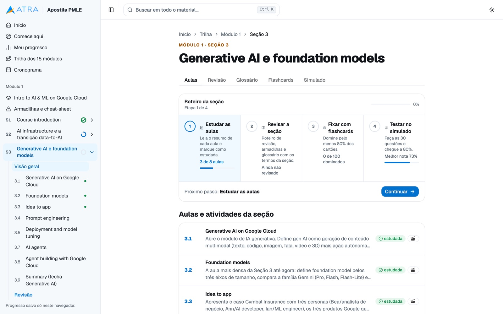
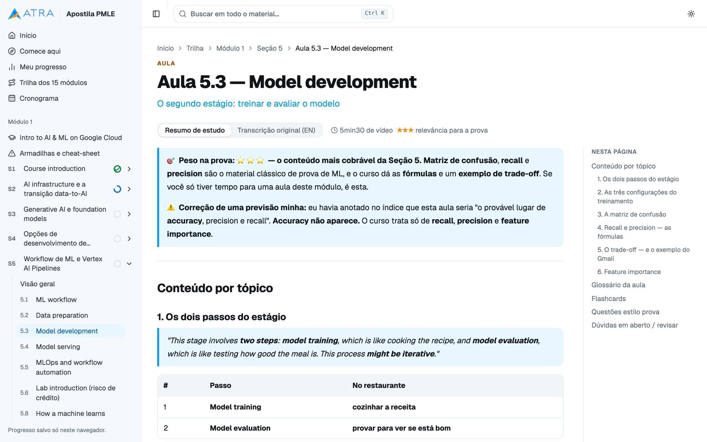
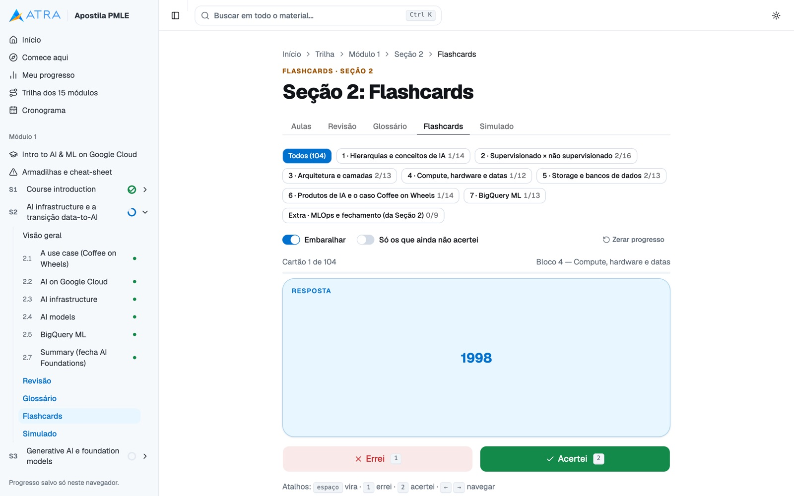
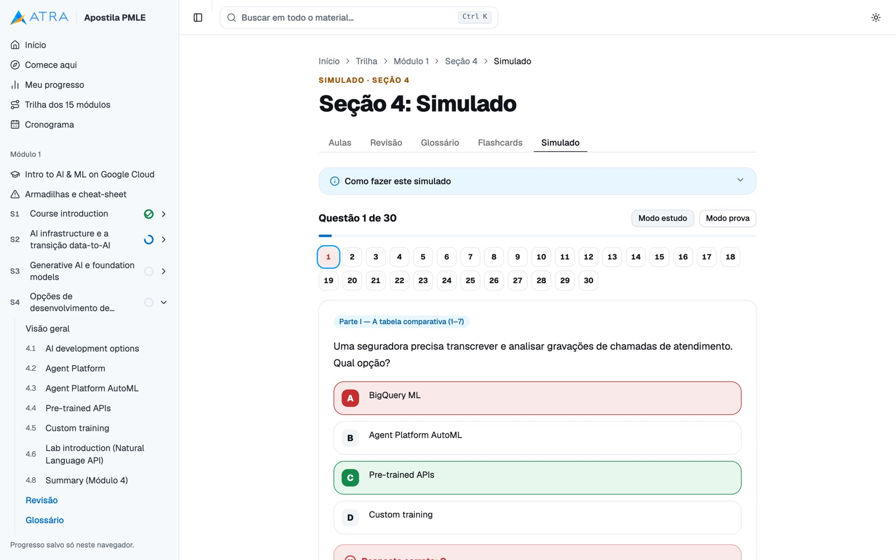
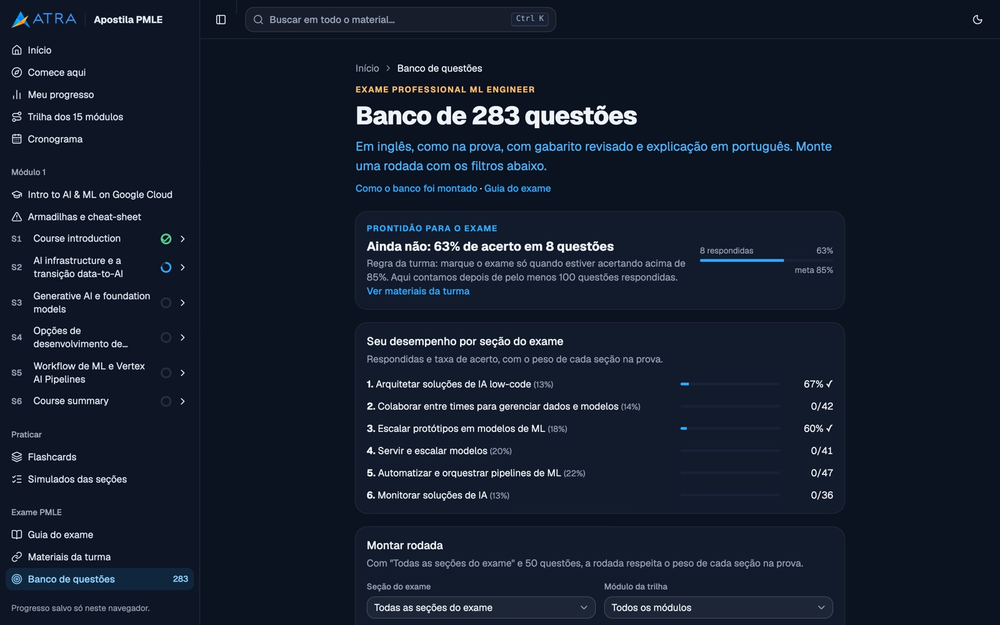
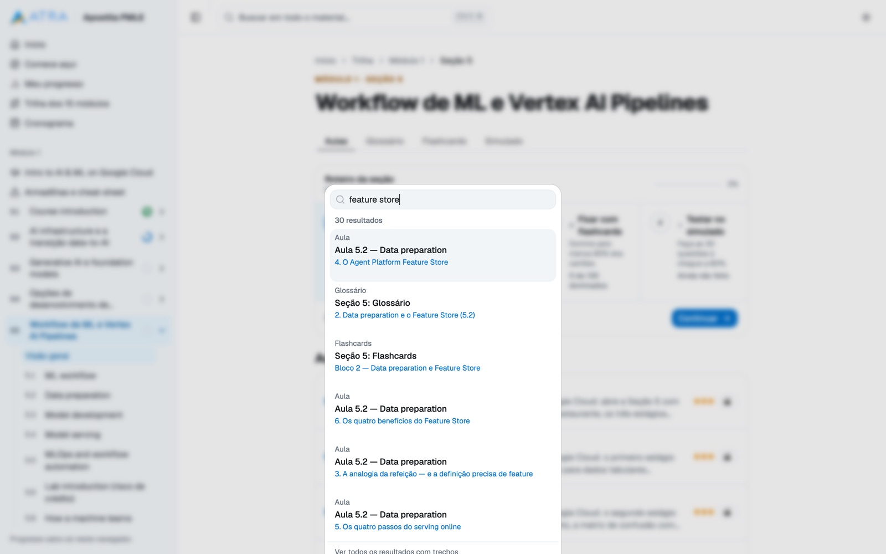
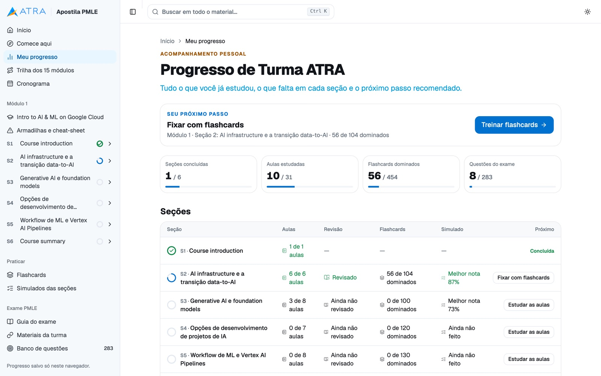
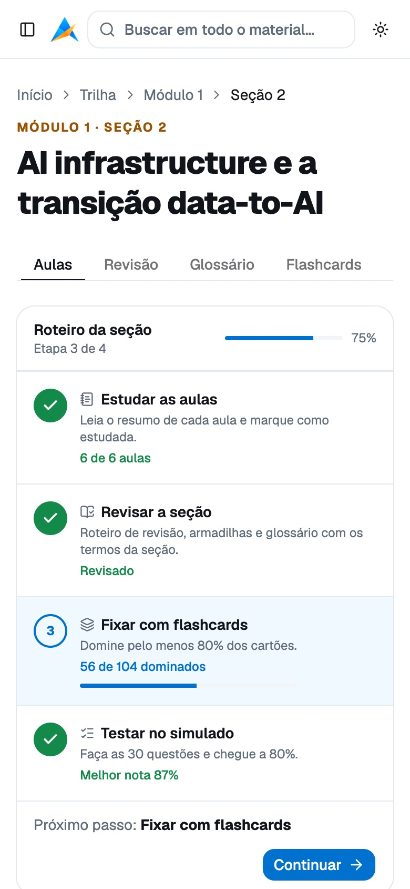
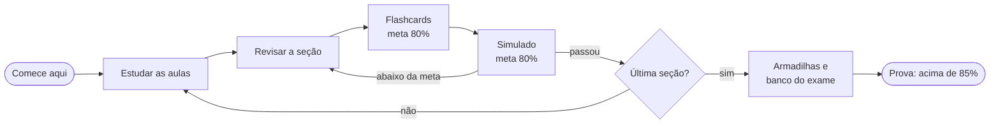
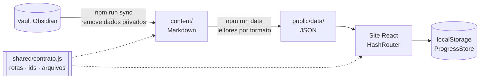

<div align="center">


<br>

**Uma apostila interativa para passar na certificação Google Cloud Professional Machine Learning Engineer.**<br>
Resumos de aula, flashcards, simulados e um banco de questões no estilo da prova, organizados numa jornada que diz o que estudar em seguida.

<br>

[](https://github.com/leonfpontes/apostila-pmle/actions/workflows/ci.yml)


[**Ver o site**](https://apostila-pmle-seven.vercel.app) · [Documentação](doc/README.md) · [Arquitetura](doc/arquitetura.md) · [Design system](doc/design-system.md)

</div>

<br>

<table>
  <tr>
    <td align="center"><b>15</b><br><sub>módulos da trilha</sub></td>
    <td align="center"><b>31</b><br><sub>aulas resumidas</sub></td>
    <td align="center"><b>454</b><br><sub>flashcards</sub></td>
    <td align="center"><b>120</b><br><sub>questões de simulado</sub></td>
    <td align="center"><b>283</b><br><sub>questões do exame</sub></td>
    <td align="center"><b>0</b><br><sub>logins necessários</sub></td>
  </tr>
</table>

## ✨ O que tem dentro


| | |
|---|---|
| 🧭 **Jornada guiada** | Cada seção segue o mesmo caminho: estudar as aulas → revisar → fixar com flashcards → testar no simulado. A página inicial sempre mostra o **próximo passo**, calculado a partir do que o aluno já fez. |
| 📚 **Aulas resumidas** | Resumo em português de cada vídeo, com relevância para a prova (★★★), índice lateral e a transcrição original em inglês ao lado. |
| 🃏 **Flashcards 3D** | Cartões que viram com espaço, atalhos `1`/`2` para errei/acertei, filtro por bloco e "só os que ainda não acertei". |
| 📝 **Simulados** | 30 questões por seção, modo estudo (correção na hora) ou modo prova (nota no fim), gabarito comentado e "refazer só as erradas". |
| 🎯 **Banco do exame** | 283 questões em inglês com explicação em português, filtros por seção do guia, módulo e dificuldade, e provas de 50 questões **com os pesos oficiais**. |
| 📈 **Prontidão** | Medidor com a regra da turma: marcar a prova só acima de **85%** de acerto. |
| 🔎 **Busca em tudo** | <kbd>Ctrl</kbd> <kbd>K</kbd> procura em aulas, glossários, flashcards e questões, ignorando acentos. |
| 💾 **Sem login** | O progresso fica no navegador; exportar e importar leva tudo para outro dispositivo. |
| 🌗 **Claro, escuro e celular** | Identidade visual da ATRA nos dois temas, responsivo até 375 px. |

## 📸 Galeria

<table>
  <tr>
    <td width="50%"><br><sub><b>Roteiro da seção</b>: etapas, metas e o botão para continuar</sub></td>
    <td width="50%"><br><sub><b>Aula</b>: resumo, relevância para a prova e índice lateral</sub></td>
  </tr>
  <tr>
    <td><br><sub><b>Flashcards</b>: filtro por bloco e progresso por cartão</sub></td>
    <td><br><sub><b>Simulado</b>: correção na hora e mapa de questões</sub></td>
  </tr>
  <tr>
    <td><br><sub><b>Banco do exame</b>: prontidão e desempenho por seção</sub></td>
    <td><br><sub><b>Busca rápida</b>: <kbd>Ctrl</kbd> <kbd>K</kbd> em todo o material</sub></td>
  </tr>
  <tr>
    <td><br><sub><b>Meu progresso</b>: cada seção, etapa por etapa</sub></td>
    <td align="center"> <br><sub><b>No celular</b>, claro e escuro</sub></td>
  </tr>
</table>

## 🧠 Como o aluno estuda



## 🏗️ Arquitetura



- **Conteúdo separado do código.** Aulas novas entram como Markdown; o build gera os dados e o site se monta sozinho (menu, jornada, busca).
- **Contrato único** entre o build (Node) e o site (TypeScript): rotas, ids e arquivos vêm de um só lugar.
- **Domínio orientado a objetos.** `ProgressStore` é a única porta para o armazenamento; as etapas da jornada são uma hierarquia (`Etapa` → `EtapaAulas`, `EtapaRevisao`, `EtapaFlashcards`, `EtapaSimulado`) registrada numa lista, então uma etapa nova não muda nada do que já existe.
- **Lógica fora da tela.** Quiz e flashcards têm hooks de estado (`useQuiz`, `useTreino`) e componentes que só desenham.
- **Design system próprio** sobre o shadcn/ui: tokens de cor e layout em CSS, utilitários (`kicker`, `card-interativo`, `superficie-destaque`) e componentes compartilhados (`Pagina`, `Destaque`, `CardLink`…).
- **Privacidade por padrão.** O repositório é público; dados da turma são filtrados antes de chegar ao Git.

Mais detalhes em [doc/arquitetura.md](doc/arquitetura.md).

## 🧰 Stack

| Camada | Tecnologia |
|---|---|
| Interface | React 19, TypeScript, React Router (HashRouter) |
| Componentes | shadcn/ui (estilo base-nova, primitivas Base UI), lucide-react |
| Estilo | Tailwind CSS 4 com tokens da identidade ATRA |
| Conteúdo | Markdown + react-markdown, remark-gfm, rehype-raw |
| Build de dados | Node.js puro, sem dependências |
| Qualidade | `tsc` estrito, oxlint, GitHub Actions |
| Hospedagem | Vercel (deploy a cada push, preview a cada PR) |

## 🚀 Rodando localmente

```bash
git clone https://github.com/leonfpontes/apostila-pmle.git
cd apostila-pmle
npm install
npm run dev        # http://localhost:5173
```

| Comando | O que faz |
|---|---|
| `npm run dev` | gera os dados e sobe o Vite |
| `npm run build` | dados + checagem de tipos + build de produção em `dist/` |
| `npm run sync` | traz aulas novas do vault Obsidian (`VAULT=/caminho`) |
| `npm run lint` | oxlint |

## 📂 Estrutura

```
content/        Markdown das aulas, glossários, flashcards, simulados e questões
shared/         contrato de rotas, ids e arquivos (build ↔ site)
scripts/        sincronização do vault e geração dos dados
src/
  domain/       regras: progresso, jornada (etapas), exame
  features/     quiz, flashcards, jornada, seção
  components/   ui (shadcn) · shared (design system) · layout
  pages/        uma página por rota
doc/            arquitetura, conteúdo, design system, desenvolvimento, deploy
```

## 🤝 Contribuindo

Para incluir aulas de um módulo novo, siga [doc/conteudo.md](doc/conteudo.md). Para mexer no código, [doc/desenvolvimento.md](doc/desenvolvimento.md) tem as convenções e receitas (página nova, etapa nova, formato novo de nota). Agentes de IA têm instruções próprias em [AGENTS.md](AGENTS.md) e [CLAUDE.md](CLAUDE.md).

<br>

<div align="center">

**Feito por [Leonardo Pontes](https://github.com/leonfpontes)** para a turma da [ATRA](https://www.atra.com.br) rumo à certificação Google Cloud.

<sub>Material de estudo não oficial. Google Cloud e Professional Machine Learning Engineer são marcas do Google.</sub>

</div>
